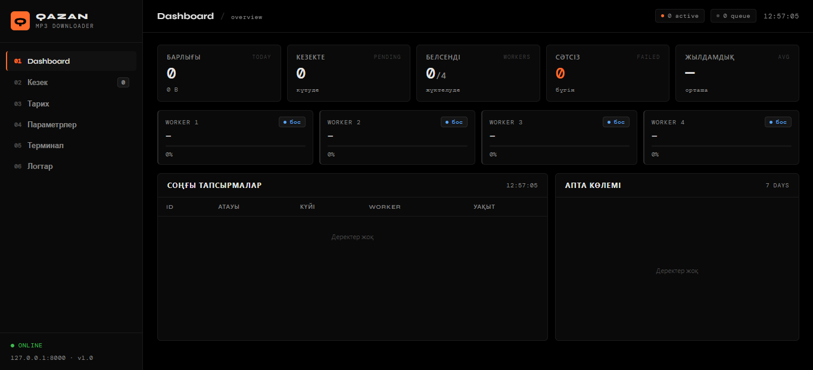
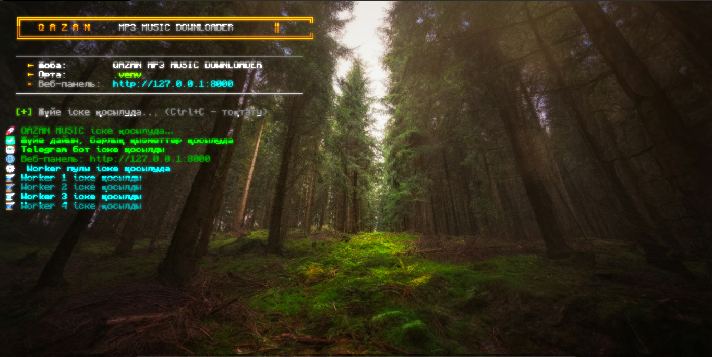
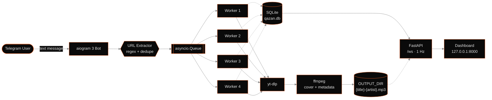

<!--
  QAZAN MP3 MUSIC DOWNLOADER — README
  License: OSL-3.0 · Copyright (c) 2026 Erom
-->

<div align="center">


<br/>


<br/><br/>

<a href="#-features"></a>
<a href="#-screenshots"></a>
<a href="#-installation"></a>
<a href="#-usage"></a>
<a href="#%EF%B8%8F-configuration"></a>
<a href="#%EF%B8%8F-architecture"></a>
<a href="#-license"></a>

</div>

---

## Overview

**QAZAN MP3 MUSIC DOWNLOADER** is a self-hosted, single-entry-point Python service that turns any batch of YouTube links into a neatly tagged 128 kbps MP3 library. Send one or more URLs to the Telegram bot — the pipeline extracts every link, deduplicates them, queues them across four asynchronous workers, and post-processes each file through `yt-dlp` + `ffmpeg` to embed your custom `art.png` cover and a fixed artist tag. A local-only FastAPI dashboard at `http://127.0.0.1:8000` streams the entire pipeline in real time: worker progress, queue depth, per-day stats, live terminal output, and editable settings — all backed by SQLite.

It is built for power users who want a reliable, unattended batch downloader with zero external dependencies beyond the local machine — no cloud accounts, no API keys, no telemetry.

---

## ✨ Features

### 🤖 Telegram Bot

- **Batch-friendly intake** — one message can contain any number of YouTube / Shorts / `music.youtube.com` URLs; the bot extracts and deduplicates them in a single pass.
- **Single acknowledgement** — one consolidated reply confirms how many tracks were queued and how many workers are active, instead of spamming per-link messages.
- **Consolidated final report** — when an entire batch finishes, the bot sends one summary line with `total / success / failed / skipped`, wall-clock duration, and average throughput.
- **Immediate per-failure alerts** — a URL that exhausts its retries triggers a standalone warning message so nothing fails silently.

### ⚙️ Download Engine

- **4 parallel async workers** — an `asyncio.Queue` fed by the bot is drained by four independent coroutines, each running `yt-dlp` + `ffmpeg` in a thread pool.
- **Dynamic worker scaling** — the pool reads `worker_count` and `max_concurrent` from the database and reloads on demand, without restarting the process.
- **128 kbps MP3 pipeline** — `bestaudio` → `FFmpegExtractAudio` → `preferredquality 128`.
- **Optional `cookies.txt`** — if the file exists next to `main.py`, authentication cookies are passed transparently to `yt-dlp`; if it doesn't, the pipeline proceeds without them.
- **Skip-existing / deduplication** — every download is pre-checked against both the target directory and the tasks table; duplicates are marked `skipped`, not re-downloaded.

### 🎨 Audio Processing

- **Cover art embedding** — `ffmpeg -map 0:a -map 1:v -id3v2_version 3` writes `art.png` into the MP3 as `Cover (Front)`.
- **Metadata injection** — the `artist` tag is applied from settings (`Qarabai Ermahan` by default); `title` is taken from `yt-dlp` metadata.
- **Graceful art fallback** — if `art.png` is missing, the pipeline logs a warning and produces a clean audio-only MP3 rather than failing the task.
- **Deterministic filenames** — the output file follows `{title}-{artist}.mp3`, sanitized for the host OS filesystem.

### 📊 Web Dashboard

- **Real-time WebSocket feed** — `/ws` pushes fresh JSON every second: worker states, queue depth, today's stats, and a 20-line log tail.
- **Six-view SPA** — Dashboard, Queue, History, Settings, Terminal, and Logs, all client-side routed with zero page reloads.
- **Editable settings with confirmation** — every change to `DEFAULT_SETTINGS` requires a confirmation modal, then persists to SQLite and immediately signals the worker pool.
- **Live terminal** — human-readable Kazakh log stream rendered in a monospaced panel with status-color semantics (green/yellow/red/blue).
- **Curated log viewer** — the Logs page parses `system.log` into level-colored, human-scannable entries instead of dumping raw file content.

### 🗄️ Data & Reliability

- **SQLite persistence** — three tables (`tasks`, `settings`, `stats_daily`) store queue, history, and time-series counters between restarts.
- **Retry with backoff** — every URL gets up to three attempts spaced by five seconds; failures never propagate up to the queue supervisor.
- **Crash-tolerant queue** — on startup, interrupted `downloading` / `processing` tasks are reset to `pending` and re-enqueued automatically.
- **Auto-cleanup** — historic rows older than `auto_cleanup_days` are purged at boot without touching completed files.

---

## 📸 Screenshots

<div align="center">



**`127.0.0.1:8000`** — stat cards, worker strip, live queue, and terminal, streamed over WebSocket.

<br/><br/>



**`python main.py`** — human-readable Kazakh logs with status colors on stdout, full detail mirrored to `system.log`.

</div>

---

## 🚀 Installation

### Prerequisites

| Requirement | Version | Notes |
| --- | --- | --- |
| **Python** | 3.11+ (3.12 recommended) | `python --version` |
| **FFmpeg** | any recent build | Must be resolvable on `PATH` |
| **Deno** | latest | Required by `yt-dlp-ejs` for YouTube JS challenges |
| **Git** | any | For cloning the repo |

### 1 · Clone the repository

```bash
git clone https://github.com/erom/qazan-mp3-downloader.git
cd qazan-mp3-downloader
```

### 2 · Create and activate a virtual environment

**Windows (PowerShell / CMD):**

```bat
python -m venv .venv
.venv\Scripts\activate
```

**Linux / macOS:**

```bash
python3 -m venv .venv
source .venv/bin/activate
```

### 3 · Install Python dependencies

```bash
pip install --upgrade pip
pip install -r requirements.txt
```

### 4 · Install Deno

`yt-dlp-ejs` requires Deno at runtime. Install it once and let `yt-dlp` pick it up from `PATH`.

**Windows (PowerShell):**

```powershell
irm https://deno.land/install.ps1 | iex
```

**Linux / macOS:**

```bash
curl -fsSL https://deno.land/install.sh | sh
```

Verify with `deno --version`.

### 5 · Add your cover art

Place your square cover at the configured path (default `C:\Users\Erom\Downloads\QAZAN MUSIC\art.png`). PNG is recommended, 500×500 or larger. If the file is missing the pipeline still runs — you just get an MP3 without embedded art.

### 6 · Configure `config.py`

Open `config.py` and edit the four values you actually need:

```python
BOT_TOKEN  = "123456789:AAExampleTokenFromBotFather"   # from @BotFather
ART_PATH   = r"C:\Users\Erom\Downloads\QAZAN MUSIC\art.png"
OUTPUT_DIR = r"C:\Users\Erom\Downloads\Music"
COOKIES_PATH = "cookies.txt"                            # optional
```

Everything else (`bitrate`, `worker_count`, `artist`, `max_retries`, …) can be adjusted later from the web dashboard at **Settings**.

### 7 · Run

**Windows — double-click `start.bat`:**

```bat
@echo off
cd /d "%~dp0"
call .venv\Scripts\activate
python main.py
pause
```

**Any platform — from the activated venv:**

```bash
python main.py
```

This single command boots the Telegram bot, the FastAPI server, and the four-worker download queue concurrently via `asyncio.gather(...)`. The dashboard becomes available at **<http://127.0.0.1:8000>** immediately.

---

## 🎮 Usage

### Telegram bot

1. Start a chat with your bot and send **`/start`**. You will receive the intro message in Kazakh.
2. Send **any message** containing one or more YouTube URLs — `youtu.be`, `youtube.com/watch`, `youtube.com/shorts`, and `music.youtube.com` are all supported. You can mix them in one message.
3. The bot extracts every unique link, enqueues each as an independent task, and replies **once**:

   > 🎵 Кезекке `N` өлең тіркелді. Қазір `active / worker_count` жүктелуде. Барлығы біткенде толық статистика жіберемін.

4. When every task in that batch reaches a terminal state, one final summary arrives:

   > ✅ Жүктеу аяқталды!
   > Жалпы: `total` | Сәтті: `success` | Сәтсіз: `failed` | Өткізілді: `skipped`
   > Уақыт: `mm:ss`
   > Орташа жылдамдық: `X.X MB/s`

5. Any URL that exhausts its retries triggers an immediate, standalone warning — you never have to wait for the batch to learn that one link failed.

### Web dashboard

Open **<http://127.0.0.1:8000>** in any modern browser. The server binds **only to `127.0.0.1`** — it is not reachable from the network and does not require authentication.

| Page | What it shows |
| --- | --- |
| **Dashboard** | Stat cards (Total, In Queue, Active Workers, Failed Today, Avg Speed), a live worker strip with per-worker progress bars, the 10 most recent tasks, and a 7-day bar chart. |
| **Queue** | Every pending / downloading / processing task with its assigned worker, attempt count, and creation time. |
| **History** | Completed, failed, and skipped tasks, filterable by status. |
| **Settings** | Every entry in `DEFAULT_SETTINGS`, editable inline. Each change opens a confirmation modal and writes to SQLite on confirm. |
| **Terminal** | A live monospaced stream of the last 120 human-readable Kazakh log lines, color-coded by status. |
| **Logs** | The last 200 lines of `system.log`, parsed into timestamp / level / module / message, and colored by severity. |

---

## ⚙️ Configuration

All settings live in `config.DEFAULT_SETTINGS`, are seeded into the SQLite `settings` table on first run, and can be edited from **Dashboard → Settings** without restarting the process (workers reload dynamically).

<details>
<summary><strong>Full settings reference</strong> (click to expand)</summary>

<br/>

| Key | Type | Default | Description |
| --- | --- | --- | --- |
| `bitrate` | string | `128k` | MP3 bitrate passed to `FFmpegExtractAudio`. |
| `format` | string | `mp3` | Preferred audio codec. |
| `worker_count` | int | `4` | Number of persistent worker coroutines. |
| `max_concurrent` | int | `4` | Upper bound of simultaneously running downloads. |
| `artist` | string | `Qarabai Ermahan` | Artist tag written into every MP3. |
| `art_path` | string | `…\QAZAN MUSIC\art.png` | Cover art embedded via ffmpeg. |
| `embed_cover` | bool | `true` | Toggle cover embedding. |
| `output_dir` | string | `…\Downloads\Music` | Destination directory for finished files. |
| `filename_format` | string | `{title}-{artist}.mp3` | Filename template (`{title}`, `{artist}`). |
| `skip_existing` | bool | `true` | Skip URLs whose target file already exists. |
| `max_retries` | int | `3` | Retry attempts per URL before marking `failed`. |
| `retry_delay_sec` | int | `5` | Delay in seconds between retries. |
| `progress_messages` | bool | `true` | Send the initial queue acknowledgement message. |
| `send_full_stats` | bool | `true` | Send the final per-batch summary. |
| `per_file_notification` | bool | `false` | Send a message per finished file (opt-in). |
| `log_level` | string | `INFO` | Threshold for `system.log`. |
| `db_path` | string | `qazan.db` | SQLite database file location. |
| `auto_cleanup_days` | int | `30` | Purge completed rows older than this at boot. |

</details>

> **Note** · `COOKIES_PATH` (`cookies.txt`) is intentionally **not** a database setting — its presence is checked against the filesystem at runtime, so you can drop it in or remove it without touching the app.

---

## 🏗️ Architecture



<details>
<summary><strong>Module-by-module breakdown</strong> (click to expand)</summary>

<br/>

**`main.py`** — the single entry point. Boots logging, initializes the database, restores interrupted tasks, then runs `asyncio.gather(bot, web, workers)` so all three subsystems share one event loop and one graceful shutdown path.

**`config.py`** — holds every constant (`BOT_TOKEN`, paths, `DEFAULT_SETTINGS`), sets up the rotating file logger targeting `system.log`, and exposes `human(...)` — a helper that prints the colorized Kazakh console line, appends it to the in-memory `RECENT_LOGS` ring buffer, and mirrors it to the file log.

**`db.py`** — a thin `aiosqlite` layer with three tables: `tasks`, `settings`, `stats_daily`. Provides the full query surface used by every other module (`enqueue_task`, `update_task_status`, `get_queue`, `get_history`, `get_dashboard_stats`, `cleanup_old_tasks`, …) and casts values on read so the dashboard never has to.

**`downloader.py`** — the heart of the pipeline. Defines the `WorkerPool` supervisor, the four persistent worker coroutines, the `yt-dlp` and `ffmpeg` wrappers, the retry loop, and the `Notifier` bridge that the Telegram module plugs into for per-URL failure alerts. All blocking work runs in `asyncio.to_thread` so the event loop stays responsive.

**`telegram_bot.py`** — aiogram 3 dispatcher. Handles `/start` and any text message, extracts and deduplicates URLs, enqueues each as a DB row + queue item, aggregates the chat's pending task IDs, and only sends the final summary once *all* of them reach a terminal state. Failure notifications are sent per-URL as they happen.

**`web.py`** — FastAPI application with a single HTML route, a handful of REST endpoints for settings/queue/history/logs, and the `/ws` WebSocket that pushes a full dashboard snapshot every second. Bound to `127.0.0.1` only.

**`templates/index.html`** + **`static/style.css`** + **`static/app.js`** — the vanilla SPA. No build step; the six views toggle via CSS classes, the WebSocket reconnects automatically with exponential backoff, and settings changes route through a confirmation modal before hitting `POST /api/settings`.

</details>

---

## 🛠️ Tech Stack

| Layer | Technology | Role |
| --- | --- | --- |
| Runtime |  | Async orchestration via `asyncio.gather` |
| Bot |  | Dispatcher, filters, message handlers |
| Web |  | REST + WebSocket surface |
| Web server |  | ASGI server |
| Download |  | YouTube extraction + format selection |
| JS challenge |  | Solves YouTube signature challenges |
| JS runtime |  | Backs `yt-dlp-ejs` |
| Transcode |  | MP3 encoding, cover + metadata embedding |
| Storage |  | Queue, history, settings, daily stats |
| Frontend |  | SPA dashboard, no build step |

---

## 📁 Project Structure

```text
qazan-mp3-downloader/
├── main.py                 # Single entry point: asyncio.gather(bot, web, workers)
├── config.py               # Constants, paths, DEFAULT_SETTINGS, logging + human() helper
├── db.py                   # aiosqlite layer: tasks, settings, stats_daily
├── downloader.py           # yt-dlp + ffmpeg pipeline, 4 async workers, retry logic
├── telegram_bot.py         # aiogram 3 handlers, URL extraction, batch stats
├── web.py                  # FastAPI app, REST endpoints, /ws WebSocket
├── requirements.txt        # Python dependencies
├── start.bat               # Windows one-click launcher
├── cookies.txt             # (optional) YouTube authentication cookies
├── art.png                 # (user-provided) cover art embedded in every MP3
├── system.log              # (runtime) INFO+ log file
├── qazan.db                # (runtime) SQLite database
├── templates/
│   └── index.html          # Single-page app shell
├── static/
│   ├── style.css           # Dark Minimalist Developer Dashboard styles
│   └── app.js              # WebSocket client + SPA view logic
└── screenshots/
    ├── website.png         # Dashboard screenshot
    └── terminal.png        # Terminal screenshot
```

---

## 🔁 Error Handling & Reliability

- **Per-URL retry** — every task gets up to **3 attempts** with a **5-second** delay between each. The retry loop is scoped to a single task, never to the worker or the queue.
- **Immediate failure notifications** — the moment a URL exhausts its retries, the originating Telegram chat receives a standalone message:

  > ⚠️ Бұл сілтеме жүктелмеді: `{url}`
  > Себебі: `{short_error}`

- **Queue isolation** — a worker never propagates an exception to the pool. Every task runs inside its own `try / except / finally` block, and `queue.task_done()` fires unconditionally so the backlog keeps flowing.
- **Skip-existing deduplication** — a download is pre-checked against the filesystem *and* against `tasks WHERE status='done'`; matching titles are marked `skipped` without consuming bandwidth or worker time.
- **Missing assets are non-fatal** — no `art.png` → warn + audio-only MP3. No `cookies.txt` → proceed without cookies. Neither condition halts the pipeline.
- **Crash-tolerant restart** — on boot, any task left in `downloading` or `processing` is reset to `pending` and re-enqueued, so a hard power-off never loses work.
- **Bounded logging surface** — tracebacks are written exclusively to `system.log`. Stdout only receives human-readable Kazakh lines, which keeps the terminal clean and prevents stack traces from surfacing through the dashboard's log stream.

---

## 🤝 Contributing

Contributions are welcome — bug reports, feature proposals, and pull requests are all appreciated. A few ground rules:

1. **Open an issue first** for anything that changes behaviour, so the design can be discussed before code is written.
2. **Keep the module boundaries** described in the Architecture section. Do not fold logic from `downloader.py` into `telegram_bot.py`, and do not introduce new top-level modules without justification.
3. **Match the style** — type annotations, `async` where appropriate, no blocking calls on the event loop.
4. **Update `README.md`** alongside any change to settings, CLI behaviour, or the dashboard.
5. By submitting a pull request you agree that your contribution is licensed under the project's **OSL-3.0** license (see [LICENSE](LICENSE)).

> Derivative works distributed under this repository must retain the original copyright notice and a prominent **Attribution Notice** describing any modifications, as required by OSL-3.0 Section 6.

---

## 📄 License


Licensed under the **Open Software License 3.0 (OSL-3.0)**.
Copyright (c) 2026 **Qarabai Ermahan**. See the [`LICENSE`](LICENSE) file for the full text.

> Any derivative work must retain the original copyright notice and a prominent **Attribution Notice** indicating that modifications were made, as required by **OSL-3.0 Section 6**.

---

## 🙏 Acknowledgements

This project would not exist without the open-source work of others. Sincere thanks to:

- **[aiogram](https://github.com/aiogram/aiogram)** — for the cleanest async Telegram framework in the Python ecosystem.
- **[FastAPI](https://github.com/fastapi/fastapi)** and **[Uvicorn](https://github.com/encode/uvicorn)** — for making a live WebSocket dashboard trivial to ship.
- **[yt-dlp](https://github.com/yt-dlp/yt-dlp)** and **[yt-dlp-ejs](https://github.com/yt-dlp/yt-dlp-ejs)** — for staying ahead of YouTube's endless changes.
- **[FFmpeg](https://ffmpeg.org/)** — for the one tool that quietly does audio, tags, and cover art in a single invocation.
- **[Deno](https://deno.land/)** — for providing the JavaScript runtime `yt-dlp-ejs` needs.
- **[SQLite](https://sqlite.org/)** and **[aiosqlite](https://github.com/omnilib/aiosqlite)** — for a zero-config, crash-proof data layer.
- The **[Shields.io](https://shields.io/)** and **[readme-typing-svg](https://github.com/DenverCoder1/readme-typing-svg)** communities — for the badges and header animation that make this README readable at a glance.

---

## 📬 Contact

<div align="center">

<a href="https://github.com/QarabaiErooom"></a>
<a href="https://t.me/@QarabaiErmahan"></a>
<a href="mailto:eromaqarabai@gmail.com"></a>

<br/><br/>

<sub><span style="color:#888888">Built with <code>asyncio</code>, <code>yt-dlp</code>, and <code>ffmpeg</code> — and not much else.</span></sub>

</div>
